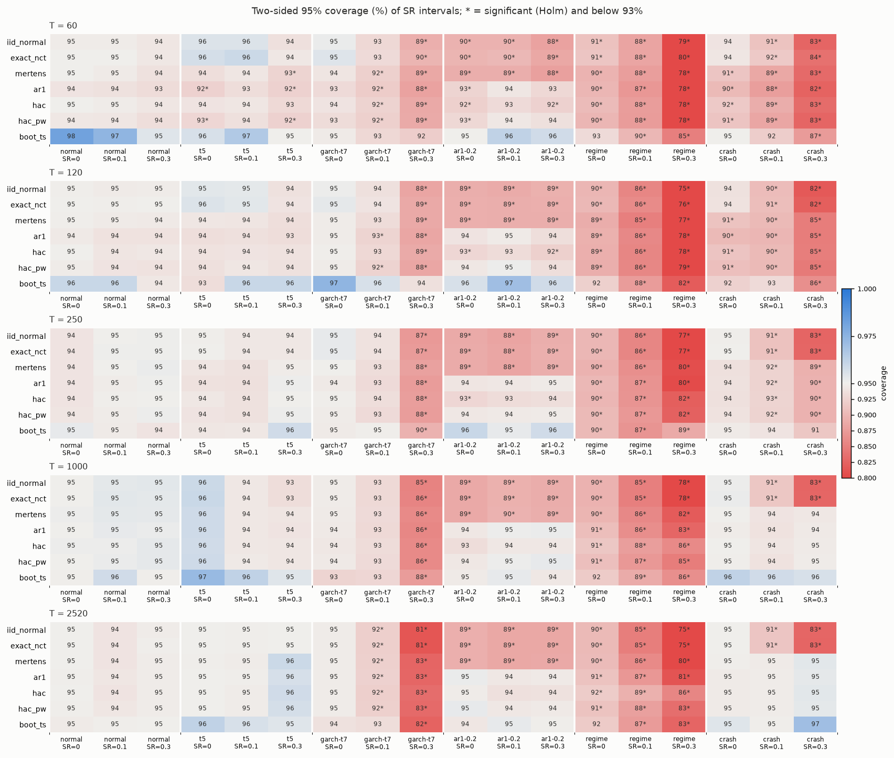

# sharpecheck report

Results of the quick Monte Carlo profile and the 1/N portfolio study, written by hand from
the committed files under `results/`. Every number below can be traced to one of those
files. The design, the formulas and the expectations that were written down before any
run are in `docs/DESIGN.md` (sections 5, 6 and 6.6). Deviations from that design are
listed in `docs/DESIGN.md` section 13.

**Summary.**

- Under iid returns (normal, t5) every method except the bootstrap keeps 95% coverage
  within Monte Carlo error from T = 60 upward. The studentized block bootstrap
  over-covers at small T: 98.2% at T = 60 under normal returns.
- With serial dependence the iid formulas fail as theory predicts: about 89% coverage
  under AR(1) with phi = 0.2. The AR(1) correction, HAC with prewhitening and the
  bootstrap repair this.
- No method reaches nominal coverage under the two processes whose dependence sits in the
  variance or the regime rather than at lag 1: GARCH(1,1)-t7 and 2-state regime switching.
  Coverage is still 81-86% at T = 2520 for every method when SR = 0.3. The cause is
  measured directly. The true variance of the SR estimator is about twice what the iid
  and AR(1) formulas give (`sr_variance.csv`), and the HAC methods' AR(1)-plug-in
  bandwidth does not capture that persistence.
- Our Ledoit-Wolf (2008) Table 1 replication agrees in 32 of 36 entries. Two Boot-IID gaps
  in the VAR cases come from a convention: which standard error studentizes the original
  statistic. A side run that uses the iid standard error gives 9.2% against LW's 8.5%.
- On correlated trials the DSR rules with the true number of trials are very
  conservative. PSR without deflation is badly oversized, up to 100% family-wise error.
  Holm over the per-trial PSR p-values exceeds 5% for fat tails with many trials.
- Portfolio study: no rule's Sharpe ratio differs from 1/N at 5% after the pre-registered
  Romano-Wolf adjustment. The closest is Ledoit-Wolf minimum variance on the 25
  size/book-to-market portfolios: adjusted p = 0.073, raw p = 0.014.

## 1. What was run

| Item | Value |
|---|---|
| Config | `configs/mc_quick.toml` (config hash `4b4c09b295deca28`), seed 20261024 |
| Coverage grid | 6 DGPs x SR {0, 0.1, 0.3} x T {60, 120, 250, 1000, 2520} = 90 cells, 7 methods |
| Replications | 2000 per cell for the analytic and HAC methods; `boot_ts` on the first 500 (B = 499, block `round(T^(1/3))`) |
| Difference tests | LW (2008) DGPs, T = 120, 5000 replications, M = 499 |
| DSR experiment | N {10, 100, 1000} x rho {0, 0.3, 0.7} x T {250, 1250} x {normal, t5}, 1000 replications per cell |
| Sizes after pilot | the timing pilot projected 39 wall minutes (> 35 budget), so `boot_reps` went 1000 -> 500 and `dsr.reps` 2000 -> 1000 (`results/mc-quick/calibration.json`) |
| Run | 984 checkpointed units, 3 worker processes, 27.7 min wall, 81 CPU-minutes inside units, no failures, no retries |
| Versions | Python 3.13.1, numpy 2.5.4, scipy 1.18.1, pandas 3.1.0, arch 8.0.0 (`results/mc-quick/summary.json`) |

Every rate has a 95% Wilson interval in the CSV files. A coverage cell is flagged as
under-covering when a one-sided binomial test of coverage < 0.95 stays significant after
Holm's correction across all 630 (cell, method) rows **and** the coverage is below 0.93.
`nan` intervals count as misses. There were none in this run.

Monte Carlo error: with 2000 replications the standard error of a coverage near 0.95 is
0.49 points; with 500 (`boot_ts`) it is 0.97 points.

## 2. Coverage of single-SR intervals



Files: `results/mc-quick/coverage.csv`, `onesided.csv`, `sr_variance.csv`.

Flagged cells per method (of 90): iid_normal 46, exact_nct 46, mertens 46, ar1 34, hac 35,
hac_pw 34, boot_ts 16. Mean absolute deviation from 0.95 over all 90 cells: boot_ts 0.024,
hac 0.030, hac_pw 0.030, ar1 0.033, mertens 0.041, exact_nct 0.044, iid_normal 0.045. No
cell was flagged as over-covering. The largest over-coverage, boot_ts under normal
returns at T = 60, SR = 0 (0.982, Wilson [0.966, 0.991]), misses the Holm threshold.

By process:

- **normal, t5.** No method is flagged under normal returns. Under t5, a few small-T cells
  of `ar1`, `hac_pw` and `mertens` (5 in all) are flagged, all between 0.92 and 0.93, all
  at T = 60. The bootstrap is wide at small T: under normal returns, SR = 0, coverage is
  0.982 at T = 60 and 0.960 at T = 120, with mean widths 13% and 7% above iid_normal.
- **ar1-0.2.** iid_normal, exact_nct and mertens cover 88-90% at every T, against the 89%
  predicted by the variance factor 1.5. ar1, hac_pw and boot_ts are at 92.6-97.0%; plain
  hac is at 92-93% at T <= 250.
- **crash.** At SR = 0.3, iid_normal and exact_nct cover about 83% at every T. The
  skewness and kurtosis terms are missing, and the empirical T Var(SR_hat) is 2.15
  against 1.045. mertens, ar1 and HAC recover with T: 82-85% at T <= 120, 89-90% at
  T = 250, 94-95% at T >= 1000.
- **garch-t7.** At SR = 0.3, coverage falls with T for every method, from about 88-92%
  at T = 60 to 81-83% at T = 2520. The empirical T Var(SR_hat) at T = 2520 is 2.27,
  while the iid formula with the population kurtosis gives 1.13. The volatility
  clustering makes r_t^2 strongly persistent (alpha + beta = 0.98), so the variance of
  the sample variance is much larger than its iid value. The (g4 - 1)/4 SR^2 term misses
  this, and so does a kernel estimator whose bandwidth comes from the lag-1
  autocorrelation of r_t^2.
- **regime.** Even at SR = 0 every method covers only 89-93% at all T. The lag-1
  autocorrelation is 0.025, but it decays only as 0.88^k. The empirical T Var(SR_hat)
  is 1.43, while the AR(1) formula gives 1.05. At SR = 0.3 coverage is 75-86% at
  T = 2520. HAC is best there (0.86) and still far from nominal.

**One-sided size** (`onesided.csv`). One-sided size is the rejection rate of
`H0: SR <= SR_true` at nominal 5%, i.e. how often a one-sided 95% lower bound lies above
the truth. Averaged over all cells of a process, boot_ts is closest: 0.048 under normal
returns, 0.047 under ar1-0.2, 0.077 under crash, 0.076 under garch-t7 and 0.105 under
regime. Both PSR conventions are oversized wherever the two-sided intervals under-cover.
At small T the LZL 2025 "null" convention is more oversized than the BLdP 2012
"observed" convention. For crash at SR = 0.3 the two give 0.220 vs 0.203 at T = 60 and
0.128 vs 0.112 at T = 250. Under normal returns both stay at 4.2-7.0% (the extremes
come from different cells).

### Pre-registered expectations (DESIGN 6.6)

| # | Expectation | Verdict | Evidence |
|---|---|---|---|
| 1 | iid_normal under-covers for crash at SR > 0 and for ar1-0.2 everywhere | confirmed | crash SR = 0.3: 82-83%; SR = 0.1: 90-91%; ar1-0.2: 88-90% in all 15 cells |
| 2 | mertens fixes t5 and crash at large T, not ar1-0.2; erratic for t5 at small T | mostly confirmed | crash SR = 0.3: 94.4% (T = 1000), 95.4% (2520); ar1-0.2 88-90%; t5 small T is mildly low (0.926-0.942 at T = 60), not erratic |
| 3 | ar1 fixes ar1-0.2 but not garch-t7 at SR > 0 | confirmed | ar1-0.2: 92.6-95.2%; garch-t7 SR = 0.3: 83-88% |
| 4 | hac/hac_pw liberal at T <= 120, near nominal at T >= 1000; prewhitening helps under ar1-0.2 | mixed | under normal and t5, hac is near 95% already at T = 60; under garch-t7 and regime it is far from nominal even at T = 2520; prewhitening helps under ar1-0.2 (hac_pw 93-95% vs hac 92-95%) |
| 5 | boot_ts closest to nominal overall, not exact at T = 60 | confirmed | lowest mean deviation (0.024) and fewest flags (16); conservative at T = 60 (98.2% under normal, SR = 0) |
| 6 | exact_nct exact for normal, inherits iid_normal's failures elsewhere | confirmed | normal: 94.0-95.4% in all 15 cells; elsewhere within about 1 point of iid_normal |
| 7 | DSR rules 1-2 conservative under independent trials; rule 5 badly oversized; rule 3 below 5% for moderate undercounting; rule 6 controls FWER; rule 7 near 5% | mixed | see section 4 |
| 8 | our difference-test sizes agree with LW Table 1 for JKM, HAC, HACPW and Boot-IID | mostly confirmed | 22 of 24 such entries agree; both misses are Boot-IID in the VAR cases (section 3) |

The surprise relative to the expectations is that HAC does not rescue the
GARCH and regime cells at large T. The design anticipated small-sample problems for HAC,
not a failure that persists at T = 2520.

## 3. Ledoit-Wolf (2008) Table 1 replication

File: `results/mc-quick/difference.csv`. Nominal 5%, T = 120, 5000 replications. The
agreement criterion is `|ours - LW| <= 3 sqrt(p (1 - p) (1/5000 + 1/5000))`, with `p` the
pooled rate. Boot-TS is compared with fixed blocks b = 4 and b = 6, whereas LW calibrate
the block size.

| DGP | JKM ours / LW | HAC | HACPW | Boot-IID | Boot-TS b=4 | Boot-TS b=6 |
|---|---|---|---|---|---|---|
| Normal-IID | 5.0 / 5.0 | 5.3 / 5.3 | 5.6 / 5.4 | 5.0 / 4.9 | 4.1 / 4.8 | **3.5** / 4.8 |
| t6-IID | 9.8 / 10.7 | 7.1 / 6.7 | 7.2 / 6.9 | 5.7 / 5.2 | 4.9 / 5.0 | 4.0 / 5.0 |
| Normal-GARCH | 6.6 / 7.2 | 6.6 / 7.1 | 6.8 / 7.2 | 6.4 / 6.0 | 5.1 / 5.5 | 4.4 / 5.5 |
| t6-GARCH | 7.4 / 7.4 | 7.3 / 7.7 | 7.3 / 7.5 | 6.8 / 6.9 | 5.8 / 5.7 | 4.5 / 5.7 |
| Normal-VAR | 9.1 / 9.5 | 7.1 / 6.9 | 6.2 / 6.1 | **5.5** / 8.5 | 4.4 / 5.0 | 3.9 / 5.0 |
| t6-VAR | 12.5 / 14.5 | 7.7 / 7.9 | 6.6 / 7.3 | **5.1** / 7.3 | 4.2 / 5.1 | **3.8** / 5.1 |

Bold entries fail the criterion (32 of 36 agree). The qualitative findings of LW
reproduce:

- JKM is liberal under fat tails and serial correlation: 12.5% for t6-VAR.
- HAC is mildly liberal at T = 120.
- The studentized block bootstrap is the only test close to or below nominal in every
  DGP.

Two mismatches are explained:

- **Boot-IID, VAR cases.** Our main run studentizes the original statistic with the
  prewhitened HAC standard error, as DESIGN 4.4 specifies. That standard error already
  absorbs the autocorrelation, so the b = 1 bootstrap is not liberal. A side run
  (`scripts/lw_bootiid_convention.py`, 2000 replications per DGP, file
  `results/mc-quick/bootiid_convention.json`) studentizes with the iid standard error
  instead. It gives 9.2% [8.0, 10.5] for Normal-VAR against LW's 8.5%, and 9.0%
  [7.8, 10.3] for t6-VAR against LW's 7.3%. The IID and GARCH rates are unchanged
  (4.4-7.1%). So the gap comes from this convention. It is not evidence about LW's
  numbers, and the t6-VAR side-run value is still somewhat above theirs.
- **Boot-TS with b = 6** is conservative (3.5-4.5%). LW's calibrated block would differ
  per data set; we did not calibrate inside the Monte Carlo (DESIGN 2, item 4). With
  b = 4 all six entries agree.

## 4. Deflated Sharpe ratio under correlated and miscounted trials

File: `results/mc-quick/dsr.csv`. All trials have SR = 0, so every rejection is a family-wise
error. 1000 replications per cell (Wilson half-width about 1.4 points at 5%).

- **psr_best** (best trial, no deflation): FWER 31-42% at N = 10 and 0.96-1.00 at
  N = 1000 with rho <= 0.3. Badly oversized, as expected.
- **dsr_trueN_estV** and **dsr_trueN_oracleV** (DSR with the true N): FWER 0-1.2% for
  rho <= 0.3 and 2-4% (estV) at rho = 0.7. Very conservative: a DSR "rejection at 95%"
  is much stricter than 5%.
- **dsr_N/10** (trials undercounted tenfold): with N = 10 this is the undeflated PSR
  (31-42%). With N = 100 it gives 5.2-11.4%, and with N = 1000 it gives 0.7-10.1%. So
  moderate undercounting is not always absorbed by DSR's conservatism, contrary to
  expectation 7.
- **dsr_impliedN** (BLdP eq. 9 from the average correlation): close to dsr_trueN_estV for
  rho <= 0.3. At rho = 0.7 it gives 4-7.5%, above the true-N rule, because it shrinks
  N while the variance input already reflects the correlation.
- **holm_psr** (Holm over the N per-trial PSR(0) p-values): mostly at or below 5%. It
  exceeds 5% at N = 1000, T = 250 with t5 trials (10.3%, Wilson about [8.6, 12.3]) and
  at N = 100, T = 250, t5 (8.1%). The normal approximation behind PSR is not accurate
  in the far tail (alpha / N = 5e-5) for fat-tailed returns at moderate T.
- **lzl_max** (best SR against the exact mean and sd of the maximum, true rho): 4.2-9.5%.
  It is liberal at N = 1000, T = 250 (9.5% normal, 7.3% t5), because the maximum's
  right tail is heavier than the normal approximation assumes.

Expectation 7 is therefore mixed:

- confirmed for rules 1-2, 5 and 7, with rule 7 liberal at large N and small T;
- refuted for rule 3 in several cells;
- only approximately confirmed for rule 6, which fails with fat tails and many trials.

## 5. 1/N versus optimised portfolios

Files: `results/portfolio/tests.csv`, `rules.csv`, `block_sensitivity.csv`, `summary.json`.

Data: Kenneth R. French Data Library, vintage 202608 (CRSP), value-weighted monthly
returns of 10 industry and 25 size/book-to-market portfolios, minus the one-month T-bill.
SHA-256 values are recorded in `results/portfolio/summary.json`. Rules are re-estimated
monthly on the previous 120 months. Out of sample runs 1973-07 to 2026-08 (638 months).

**Primary test** (fixed in DESIGN 5.4 before the run): LW studentized circular block
bootstrap, two-sided, M = 4999, block 9, Romano-Wolf adjusted over the 8 comparisons
against 1/N, full period, alpha = 0.05. **Result: no rule is significantly different from
1/N.**

| Dataset | Rule | SR (monthly) | 95% CI (boot_ts) | SR - SR(1/N) | raw p | Romano-Wolf p | JKM p |
|---|---|---|---|---|---|---|---|
| ind10 | 1/N | 0.159 | [0.071, 0.247] | | | | |
| ind10 | inverse_vol | 0.163 | [0.075, 0.252] | 0.004 | 0.170 | 0.441 | 0.174 |
| ind10 | gmv_sample | 0.166 | [0.087, 0.245] | 0.007 | 0.831 | 0.831 | 0.820 |
| ind10 | gmv_lw | 0.172 | [0.093, 0.252] | 0.013 | 0.641 | 0.700 | 0.624 |
| ind10 | hrp | 0.166 | [0.078, 0.254] | 0.007 | 0.319 | 0.602 | 0.319 |
| ff25 | 1/N | 0.160 | [0.070, 0.250] | | | | |
| ff25 | inverse_vol | 0.164 | [0.074, 0.255] | 0.005 | 0.091 | 0.281 | 0.009 |
| ff25 | gmv_sample | 0.241 | [0.153, 0.330] | 0.082 | 0.032 | 0.127 | 0.021 |
| ff25 | gmv_lw | 0.234 | [0.142, 0.326] | 0.075 | 0.014 | 0.073 | 0.011 |
| ff25 | hrp | 0.164 | [0.073, 0.254] | 0.004 | 0.291 | 0.602 | 0.259 |

Annualized SR (x sqrt(12), iid scaling) for the ff25 minimum-variance rules: 0.84
(sample) and 0.81 (Ledoit-Wolf), against 0.55 for 1/N. Mean monthly turnover is 0.82 for
ff25 sample GMV, 0.34 for ff25 Ledoit-Wolf GMV and 0.018 for 1/N. Transaction costs are
not modelled, and they would work against the GMV rules.

Secondary evidence:

- Unadjusted, three ff25 comparisons have p < 0.05 by JKM (the test DeMiguel, Garlappi
  and Uppal used) and two by the bootstrap. This is how a 1/N comparison can look
  significant without multiplicity control.
- Holm-adjusted JKM and LW HAC p-values are all above 0.05.
- In the DGU era (1973-07 to 2004-11) and after publication (2004-12 to 2026-08) no
  adjusted p-value is below 0.13.
- Block-size sensitivity: the adjusted p-value for ff25 Ledoit-Wolf GMV ranges from
  0.058 to 0.082 over b in {1, 2, 4, 6, 8, 10}, so the conclusion does not depend on the
  block size.

Calibrated block size (LW Algorithm 3.1) and the model confidence set were not run (both
were "should" items, `calibrate_block = false` in `configs/portfolio.toml`).

## 6. Limitations

- **Quick profile only.** Bootstrap coverage cells use 500 replications (SE about 1
  point) and DSR cells 1000. The full profile (`configs/mc_full.toml`: 10,000
  replications, B = 999, more T and SR levels) is projected at 15-25 CPU-hours and was
  not run:

  ```sh
  uv run python scripts/run_with_retry.py --log runs/mc-full/retry.log -- \
      uv run sharpecheck mc run --config configs/mc_full.toml --workers 3
  uv run sharpecheck mc report --config configs/mc_full.toml
  ```

- **Fixed bootstrap block size** (`round(T^(1/3))`) in the Monte Carlo. A larger or
  calibrated block might improve `boot_ts` under GARCH and regime switching. This was not
  tested.
- **HAC bandwidth.** Only the Andrews (1991) AR(1) plug-in rule was tested. Its failure
  under GARCH and regime switching may not carry over to other rules, such as Newey-West
  (1994) or a fixed-b asymptotic. That is a direction for follow-up work, not a result.
- **DGP choices drive the headline.** The GARCH (alpha + beta = 0.98) and regime
  (p11 = 0.98, p22 = 0.90) parameters are persistent but typical of daily equity
  returns. Less persistent processes would give milder results.
- **Truth is the population SR.** The small-sample upward bias of SR_hat counts against
  coverage, as intended. It reaches 0.060 at T = 60 (crash, SR = 0.3) and 0.018 at
  T = 250 (`sr_variance.csv`).
- **Portfolio study.** Results are tied to the data vintage, which the library revises.
  There are no transaction costs. Turnover drifts weights with excess rather than total
  returns. There is no numerical comparison with DGU's tables (different sample).
- **Not verified here.** CI has not run on GitHub; the repository has not been pushed.